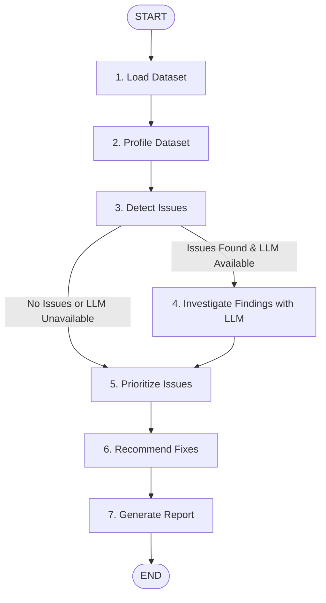

# DataSentry AI — The Silent Data Error Detective

> An autonomous data-quality investigation agent built with Python, LangGraph, pandas, and Streamlit that uncovers hidden corruptions, duplicates, formatting anomalies, and business rule violations before they distort downstream decision-making.

---

## 1. Project Overview & Features

Data quality problems often slip silently into analytical warehouses and machine learning pipelines: missing foreign keys, double-counted transactions, splintered categorical labels (e.g., `"Electronics"` vs `" electronics"`), unparseable dates, negative values where prohibited, and statistical outliers.

**DataSentry AI** treats data quality inspection as an intelligent investigation:
- **7-Node LangGraph StateGraph Workflow**: Rigorous agent orchestration that tracks dataset state, profiles distributions, detects issues deterministically, and integrates an LLM for business impact analysis and remediation advice.
- **Robust Deterministic Checkers**: Missing values, exact duplicate rows, partial business record duplicates, invalid calendar dates, inconsistent casing/whitespace, negative values violating business rules, and statistical outliers via Interquartile Range (IQR).
- **Distinguishes Confirmed Violations from Potential Anomalies**: Statistical outliers and composite duplicates are transparently flagged as *Potential Anomalies* for human review rather than being erroneously labeled as errors.
- **Graceful Fallback When No API Key Configured**: All deterministic checks, profiles, and reports function completely without an LLM API key. If no LLM key is configured, the interface clearly indicates that deterministic mode is active.
- **Privacy-Preserving AI Analysis**: Full datasets are **never** transmitted to the LLM. The agent shares only aggregated statistics, column metadata, and minimal anonymized sample values.
- **Interactive, Reversible Remediation Engine**: DataSentry AI **never** modifies the original uploaded file. Users review proposed fixes with checkboxes, preview the transformed dataset with before/after diff metrics, and download the cleaned CSV.

---

## 2. Architecture & LangGraph Workflow

The agent uses a typed `StateGraph(AgentState)` with 7 discrete nodes and conditional edge routing:



### The 7 Nodes:
1. **Load Dataset** (`load_dataset_node`): Validates file format (`.csv`, `.xlsx`, `.xls`), enforces size/row limits, and captures column data types.
2. **Profile Dataset** (`profile_dataset_node`): Computes null counts, cardinalities, duplicate counts, numeric distributions (min, max, mean, std, quartiles, IQR), and string metrics.
3. **Detect Issues** (`detect_issues_node`): Runs empirical checks and compiles evidence, affected rows, and sample records.
4. **Investigate Findings** (`investigate_findings_node`): Leverages an OpenAI-compatible LLM to explain domain business impact and verify severity based on provided evidence (skipped if LLM is unavailable).
5. **Prioritize Issues** (`prioritize_issues_node`): Ranks findings by category (Confirmed Violations first), severity level (`critical` > `high` > `medium` > `low`), and impact volume.
6. **Recommend Fixes** (`recommend_fixes_node`): Formulates safe, non-destructive remediation proposals.
7. **Generate Report** (`generate_report_node`): Synthesizes the structured JSON report with findings, limitations, and summary statistics.

---

## 3. Project Structure

```
DataSentry AI/
├── app.py                  # Streamlit web application & interactive UI
├── agent.py                # LangGraph 7-node StateGraph definition & workflow
├── graph_state.py          # TypedDict state definitions (AgentState, FindingDict)
├── data_loader.py          # Safe file loader with validation for CSV & Excel
├── profiler.py             # Statistical data profiler & column analyzer
├── checks.py               # Deterministic data-quality detectors & business rules
├── llm_analyzer.py         # Privacy-preserving LLM analyzer with Pydantic validation
├── remediation.py          # Non-destructive proposed dataset cleaning engine
├── report_generator.py     # Structured JSON & CSV report generator
├── config.py               # Configuration & environment variable manager
├── requirements.txt        # Python package dependencies
├── .env.example            # Template for environment variables
├── .gitignore              # Ignored files and patterns
├── README.md               # Project documentation
├── sample_data/
│   └── messy_sales.csv     # Sample dataset demonstrating known data anomalies
└── tests/
    ├── __init__.py
    ├── test_checks.py       # Unit tests for individual data quality checks
    ├── test_data_loader.py  # Tests for file validation, sizes, and formats
    ├── test_agent.py        # Integration tests for LangGraph execution & fallback
    └── test_remediation.py  # Tests verifying non-destructive cleaning engine
```

---

## 4. Prerequisites & Installation

### Prerequisites
- Python 3.11, 3.12, or 3.13
- Git

### Installation Steps

1. Clone or navigate to the project directory:
   ```bash
   cd "c:\Users\nanda\Projects\DataSentry AI"
   ```

2. Install dependencies:
   ```bash
   pip install -r requirements.txt
   ```

---

## 5. Environment Variable Setup

Copy the `.env.example` file to create your `.env`:
```bash
cp .env.example .env
```

Edit `.env` with your preferred settings:
```env
# Optional: OpenAI or OpenAI-compatible API key (leave blank to run in pure deterministic mode)
OPENAI_API_KEY=your_openai_api_key_here

# Optional: Custom endpoint (Ollama, Groq, OpenRouter, etc.)
# OPENAI_BASE_URL=https://api.openai.com/v1

LLM_MODEL=gpt-4o-mini
MAX_FILE_SIZE_MB=25
MAX_ROWS_LIMIT=100000
```

> **Note:** If no API key is set, DataSentry AI will function smoothly using its deterministic rules and will explicitly inform you that LLM explanations are unavailable.

---

## 6. Running the Automated Tests

Run the full pytest suite with verbose output:
```bash
pytest -v
```

All 17 automated tests cover:
- Clean data produces zero false positive violations
- Missing values and required ID checks
- Exact duplicate row detection
- Composite business duplicate detection
- Invalid calendar date and out-of-range year detection
- Inconsistent category whitespace and capitalization detection
- Negative value detection for constrained numeric columns
- Outliers correctly flagged as *Potential Anomaly* rather than confirmed errors
- File format validation (CSV and Excel), size limits, and row limits
- Non-destructive dataset remediation (original DataFrame is never mutated)
- LangGraph end-to-end execution without LLM credentials

---

## 7. Launching the Streamlit Application

Start the web application:
```bash
streamlit run app.py
```

Open your browser at `http://localhost:8501`.

---

## 8. Example Usage Walkthrough

1. **Upload or Select Sample**: Click **🧪 Load Sample Messy Dataset** in the top-right to immediately load the bundled `messy_sales.csv` file.
2. **Review Profile**: View dimensions, column names, null counts, and raw sample records.
3. **Configure Rules (Optional)**: Use the sidebar to configure required ID columns, non-negative columns, or adjust the outlier IQR threshold.
4. **Investigate**: Click **🛡️ Investigate Dataset with LangGraph**. Watch the progress bar advance through all 7 nodes.
5. **Inspect Findings**:
   - Filter by severity (Critical, High, Medium, Low) or category (Confirmed Violation vs Potential Anomaly).
   - Expand any card to see empirical evidence, business impact, and problematic sample rows.
6. **Export Report**: Download the structured report in **JSON** or the findings table in **CSV**.
7. **Clean & Remediate**: Under *Remediation & Proposed Data Cleansing*, check the boxes for the fixes you approve (e.g., drop duplicates, title-case categories, fix negative values), click **Apply Approved Fixes**, review the before/after diff metrics, and download the cleaned CSV.

---

## 9. Known Limitations

- **Statistical Outliers**: Outlier detection via IQR identifies numbers in the extreme tails of the distribution. These are flagged for human review because legitimate high-value transactions or bulk discounts can be statistically unusual without being incorrect.
- **Unstructured Free Text**: Unstructured text fields (such as open customer feedback or free-form notes) may contain domain-specific terminology that automated rules do not parse.
- **Remediation Discretion**: Automated data transformations (such as imputation) should be reviewed by domain experts prior to overwriting production tables.
